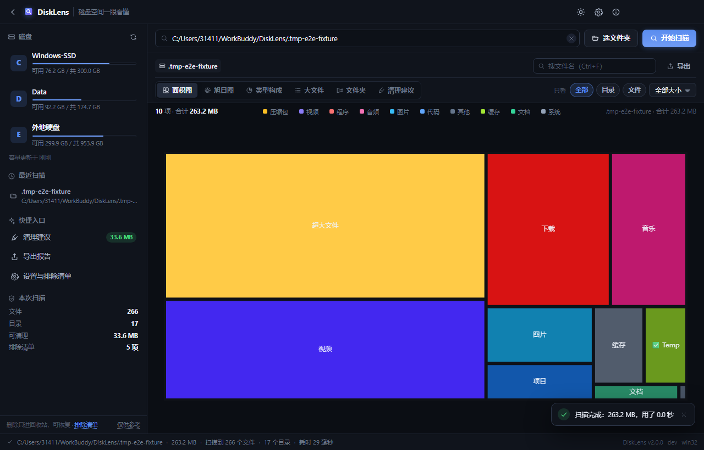
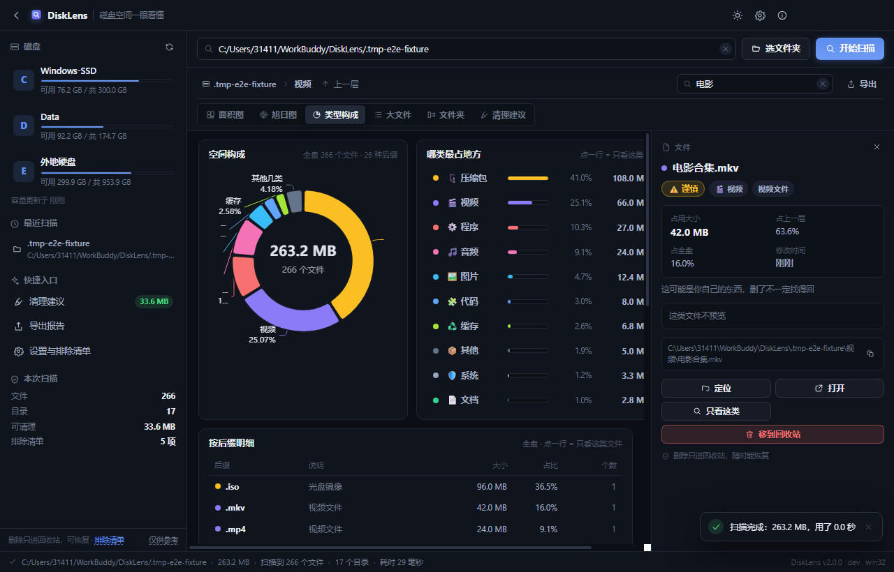
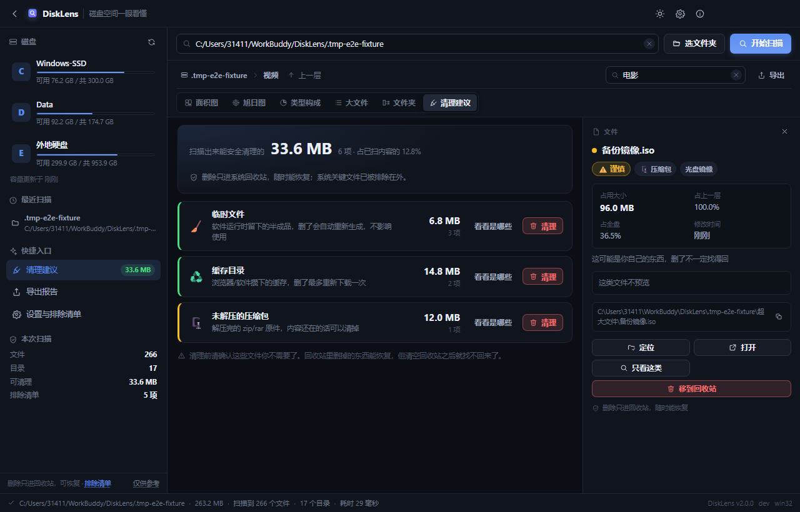
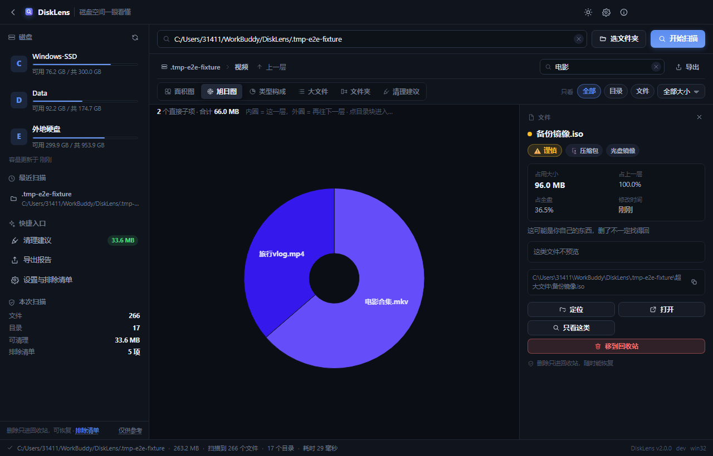
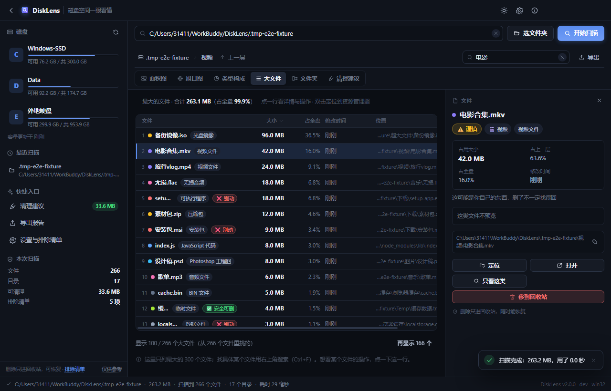
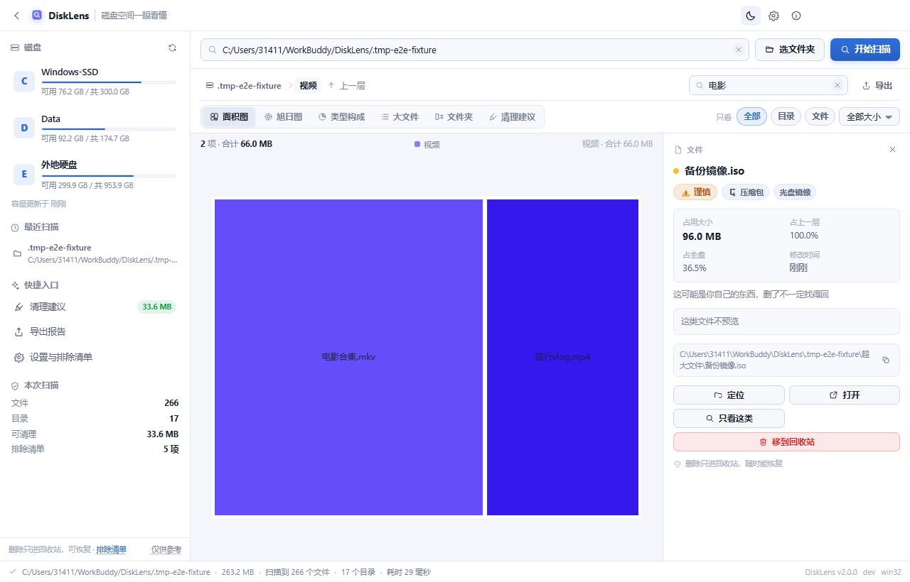
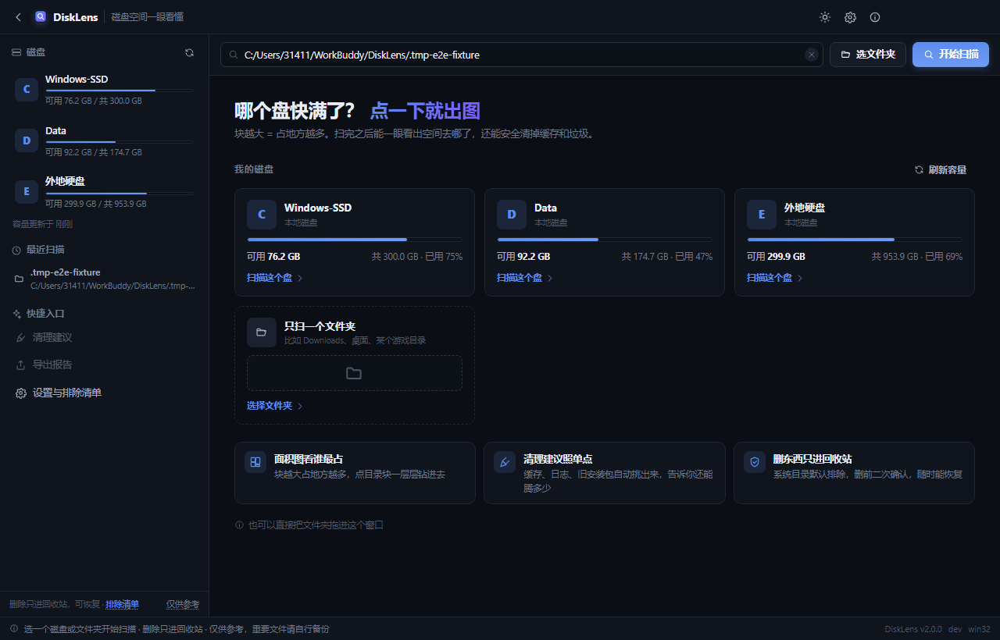

# DiskLens

> 给电脑小白的磁盘空间可视化工具：**块越大 = 占地方越多**，一眼看懂，安全清理。

C 盘又飘红了？资源管理器翻半天找不到到底谁占了地方？DiskLens 扫一遍，用一张图告诉你答案——
还会顺手把「哪些能安全删、能腾出多少」列成清单，照着点就行。

[](../../actions)
[](LICENSE)
[](../../releases)



## ✨ 功能一览（V2.0）

| 功能 | 说明 |
| --- | --- |
| 💽 磁盘首页 | 打开就能看到每个盘的占用条、可用空间；点一下直接开始扫，不用手打路径 |
| 🔍 选盘 / 选目录 / 拖拽 | 输入路径、点按钮选文件夹、或直接把文件夹拖进窗口，三种方式都行 |
| ⏱️ 实时进度 + 可取消 | 边扫边显示已扫文件数/目录数/体积/当前路径，随时能取消，不留半截结果 |
| ▦ 面积图（Treemap） | 块面积 = 占用空间，颜色 = 文件大类；点目录下钻，点文件看详情 |
| 🌀 旭日图 | 内圈是这一层，外圈是下一层，两层结构一眼看穿 |
| 🥧 类型构成 | 环形图 + 排行表 + 后缀明细：到底是视频、照片还是缓存吃掉了空间 |
| 📊 大文件榜 | 全盘最大的 300 个文件，可按大小/名称/时间排序，双击定位 |
| 📁 文件夹榜 | 最占地方的目录排行，点一行直接进那个目录 |
| 🧹 清理建议 | 临时文件、日志、缓存、未下完的下载、旧安装包自动归类，告诉你一共能腾多少 |
| 🗂️ 详情面板 | 大小/占比/修改时间/风险等级 + 图片缩略图 + 文本预览 + 一键盘操作 |
| 🖱️ 右键菜单 | 原生菜单：打开、定位、复制路径、只看这类、进入目录、移到回收站 |
| 🛡️ 排除清单 | Windows/AppData/回收站等默认勾选跳过；可自定义，防止把系统目录拖进图表 |
| 🏷️ 风险分级 | ✅ 安全可删 / ⚠️ 谨慎 / ❌ 别动，直接标在块、行、详情面板上 |
| 📖 后缀名词典 | `.pdf` = PDF 文档、`.mp4` = 视频文件…… 130+ 常见后缀说人话 |
| 🌗 深浅主题 | 深色 / 浅色 / 跟随系统，标题栏也跟着变；设置自动保存 |
| 💾 记忆与恢复 | 记住上次扫描路径与窗口尺寸；设置跨启动保留 |
| 📤 导出报告 | 概览 + 类型构成 + 大文件清单导出 CSV，Excel 双击就能看 |
| ⌨️ 快捷键 | `Ctrl+O` 选文件夹、`Ctrl+F` 搜索、`F5` 重扫、`Ctrl+E` 导出、`Backspace` 返回上一层 |

<table>
  <tr>
    <td width="50%"></td>
    <td width="50%"></td>
  </tr>
  <tr>
    <td width="50%"></td>
    <td width="50%"></td>
  </tr>
</table>

浅色主题与欢迎页：

<table>
  <tr>
    <td width="50%"></td>
    <td width="50%"></td>
  </tr>
</table>

## 🛡️ 安全承诺

- **只能进回收站**：删除操作只走系统回收站（可恢复），主进程不提供任何直接删除 API
- **删前二次确认**：批量清理也只有一个确认弹窗，明确写出「多少项、多少空间、能不能恢复」
- **系统文件劝退**：判定为「❌ 别动」的文件不会被收进清理建议，删除时额外警告
- **不碰系统目录**：排除清单默认勾选 Windows/AppData/回收站/卷影副本，扫描时整棵跳过
- **只读扫描**：扫描过程只读目录与文件属性，不改你的任何文件

> ⚠️ DiskLens 仅供参考，清理前请自行确认重要文件已备份。

## 🚀 快速开始

### 下载使用

前往 [Releases](../../releases) 页面下载最新版安装包（Windows / macOS / Linux），双击安装即可。

### 开发运行

需要环境：Node.js 20+ 和 npm。

```bash
git clone https://github.com/<你的用户名>/DiskLens.git
cd DiskLens

npm install        # 装依赖
npm run dev        # 开发模式（热更新）

npm run build          # 类型检查 + 编译
npm run build:win      # 打 Windows 安装包
npm run build:mac      # 打 macOS 安装包
npm run build:linux    # 打 Linux 安装包
```

**中国大陆网络提示**：如果 `npm install` 下载 Electron 二进制失败，先设镜像再装：

```bash
npm config set registry https://registry.npmmirror.com
npm config set electron_mirror https://npmmirror.com/mirrors/electron/
npm install
```

### 自测（真机跑打包产物）

仓库自带两个脚本，直接驱动 Electron 跑真实界面，不需要额外装浏览器：

```bash
npm run build && npm run e2e     # 35 项端到端断言 + 每步截图（.tmp-smoke/shots）
npm run audit                    # 布局/文案/图表像素审计（.tmp-smoke/audit）
```

`e2e` 会造一个假磁盘（各种类型的文件、缓存、空目录、一堆小文件），
走完「欢迎页 → 扫描 → 六视图 → 搜索 → 详情 → 清理确认 → 主题 → 重启恢复」整条路径。

## 🧱 技术栈

| 层 | 选型 | 干什么 |
| --- | --- | --- |
| 框架 | Electron 44 | 跨平台桌面壳（窗口、回收站、定位资源管理器） |
| 界面 | React 19 + TypeScript | 渲染层，组件化 UI |
| 图表 | ECharts 6（按需引入） | 面积图 / 旭日图 / 环形图，同一份数据多种渲染 |
| 脚手架 | electron-vite | 与 Vite 一致的心智模型，开发热更新 |
| 状态管理 | Zustand | 轻量，渲染层状态 |

进程架构（餐厅比喻）：

```
┌─ 主进程 Main ──────── 大堂经理：窗口/磁盘枚举/设置持久化/回收站/导出
├─ 扫描进程 Scanner ─── 后厨：独立窗口跑文件遍历，进度经 IPC 实时上报，可取消
└─ 渲染层 Renderer ───── 菜单屏：React + ECharts 六视图 + 详情面板
```

**统一数据契约**：扫描产物 = 一棵 JSON 树
`{ 名称, 路径, 大小, 类型, 修改时间, 子节点[] }`

六个视图只是同一份数据的不同渲染——切换视图不重复扫盘，筛选 = 前端过滤这棵树。

**目录结构**

```
src/
├─ main/       主进程：窗口、磁盘枚举、设置、回收站、导出、右键菜单
├─ preload/    渲染层 API 桥（contextBridge 白名单）
├─ scanner/    扫描进程（preload 里跑 fs 遍历，页面是空壳）
├─ renderer/   React 界面（store / components / lib / assets）
└─ shared/     两侧共用：数据契约、格式化、后缀词典、风险分级、排除清单
```

## 🧭 已知边界（说实话的部分）

- **百万文件级的盘**：扫描结果是一棵内存树，真正百万文件的盘约占几百 MB 内存。
  实测不崩不卡（列表只渲染当前层的 TopN），但老机器扫整盘时建议先取消勾选大目录。
- **扫描速度**：普通家用盘扫几十万文件在几秒到几十秒；机械盘 + 百万文件可能要几分钟。
  扫描过程随时可以取消。
- **结果是内存态**：关掉应用就没了（下次重扫），扫描结果缓存与增量扫描在 V2.x 计划里。
- **权限受限目录**：系统目录普通权限读不到，会跳过并在状态栏显示「N 项跳过」，点开能看到具体路径。

## 🗺️ 路线图

- **V2.0**（当前）：磁盘首页、六视图、详情面板与预览、批量清理、右键菜单、深浅主题、
  设置持久化、导出报告、扫描取消、错误兜底
- **V2.x**：重复文件检测（争议中）、按时间/大小区间筛选、扫描结果缓存与增量扫描
- **V3+**：视反馈而定。MFT 秒扫永远不做（需要管理员权限，WinDirStat 的主场）

## 🤝 贡献

欢迎 Issue 和 PR！请先读 [CONTRIBUTING.md](CONTRIBUTING.md)。提交信息用中文，一个 PR 只做一件事。

## 🙏 参考与致谢

站在巨人肩膀上，向这些项目致敬：

- [WinDirStat](https://windirstat.net/) —— Windows 磁盘分析鼻祖（本项目的功能参照）
- [Space Radar](https://github.com/zz85/space-radar) —— 验证了 Electron + D3 跨平台路线
- [SquirrelDisk](https://github.com/adileo/squirreldisk) —— Tauri 旭日图实现参考
- [Czkawka](https://github.com/qarmin/czkawka) —— 重复文件检测的护城河

## 📄 License

[MIT](LICENSE) © 2026 DiskLens Contributors

---

## English (short)

**DiskLens** is a free, open-source disk space visualizer for everyday users: the bigger the block,
the more space it takes. Scan a drive, see what's eating your disk in one picture, and clean up
safely — deletions only ever go to the Recycle Bin, with confirmation. Six views (treemap, sunburst,
type breakdown, largest files, largest folders, cleanup suggestions), a details panel with previews,
dark/light themes, CSV export, and keyboard shortcuts. Built with Electron + React + TypeScript +
ECharts. MIT licensed.
