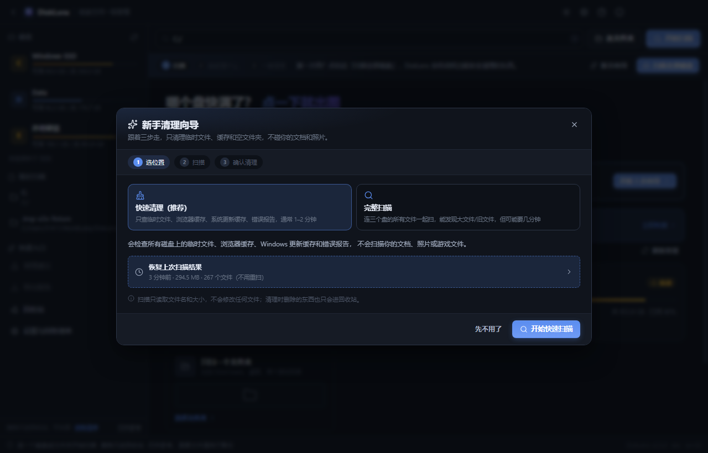
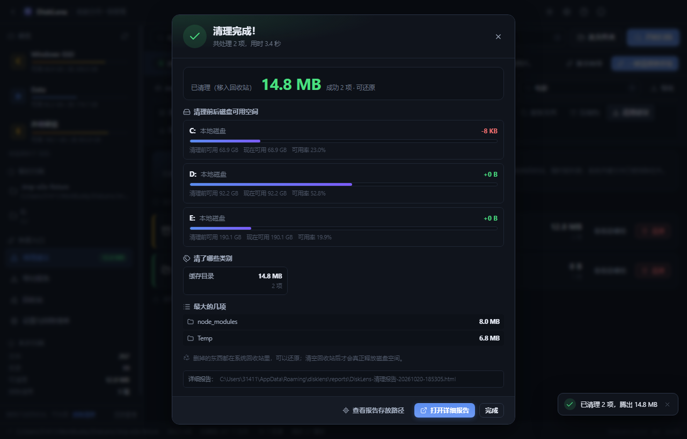
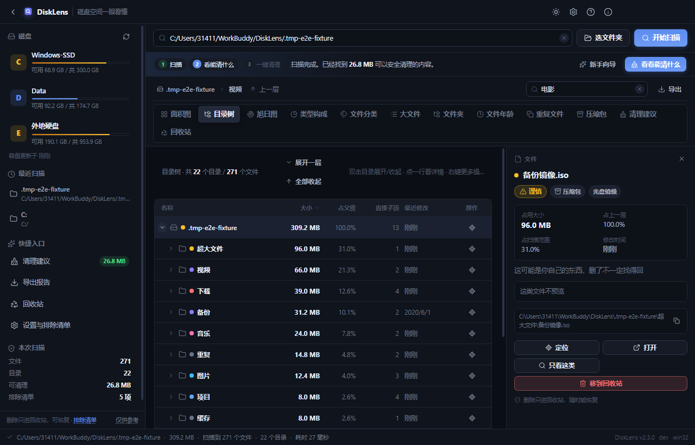
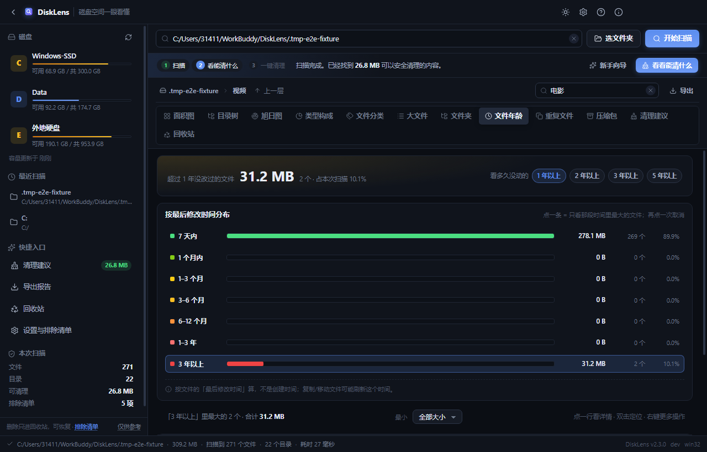
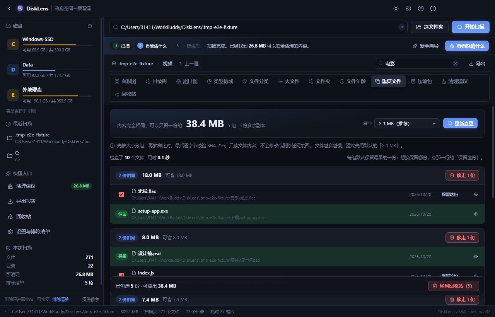
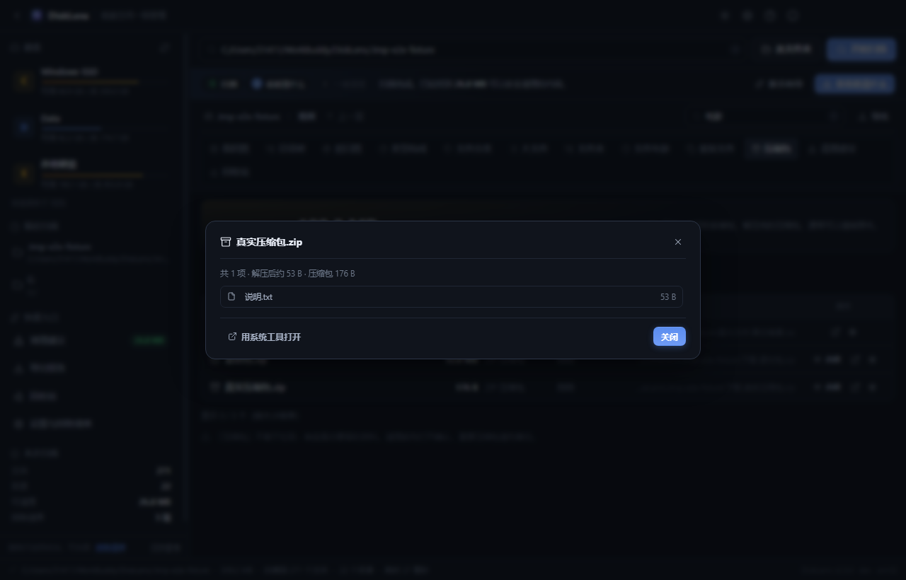
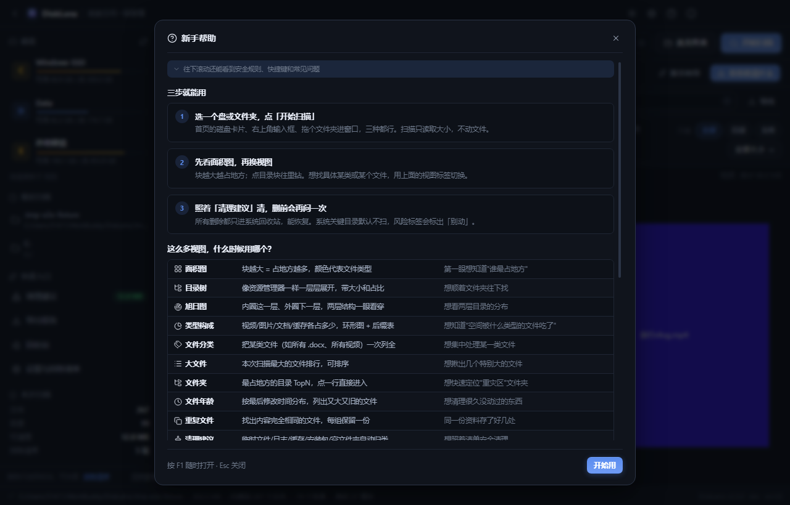

# DiskLens

> 给电脑小白的磁盘空间可视化工具：**块越大 = 占地方越多**，一眼看懂，安全清理。

C 盘又飘红了？资源管理器翻半天找不到到底谁占了地方？DiskLens 扫一遍，用一张图告诉你答案——
还会顺手把「哪些能安全删、能腾出多少」列成清单，照着点就行。

[](../../actions)
[](LICENSE)
[](../../releases)


## ✨ 功能一览（V2.3）

| 功能                            | 说明                                                                                                                   |
| ------------------------------- | ---------------------------------------------------------------------------------------------------------------------- |
| **新手清理向导**（V2.3 新增）   | 3 步：选位置 → 自动扫描 → 确认清理。默认只勾安全项，不碰文档/照片                                                      |
| **一次管理员授权**（V2.3 新增） | 系统缓存需要权限时，整批只弹 **1 次 UAC**；用 `SHFileOperation` 每批 300 项批量移到回收站，不会一个文件弹一次          |
| **清理报告弹窗**（V2.3 新增）   | 每次清理后自动弹出：释放了多少、清理前后各盘可用空间、清了哪些类别、最大的几项                                         |
| **详细 HTML 报告**（V2.3 新增） | 自动写到 `userData/reports/`；弹窗底部可直接「查看报告存放路径」「打开详细报告」                                       |
| **可选彻底释放**（V2.3 新增）   | 默认只进回收站；在向导里明确勾选后，才把**本次项目**从回收站彻底删除，磁盘可用空间立即增加                             |
| 磁盘首页                        | 打开就能看到每个盘的占用条、可用空间；点一下直接开始扫，不用手打路径                                                   |
| 选盘 / 选目录 / 拖拽            | 输入路径、点按钮选文件夹、或直接把文件夹拖进窗口，三种方式都行                                                         |
| **多盘一起扫**（V2.3 新增）     | 支持 `C:/;D:/;E:/` 或一次选择多个位置；扫描树自动生成「全部磁盘」汇总根                                                |
| **扫描快照**（V2.3 新增）       | 扫描完成自动保存压缩快照；下次打开可「恢复上次扫描结果」，不用重扫几十万文件                                           |
| 实时进度 + 可取消               | 边扫边显示已扫文件数/目录数/体积/当前路径，随时能取消，不留半截结果                                                    |
| **快速清理扫描**（V2.3 新增）   | 只扫 22 个已知临时/缓存目录（浏览器缓存、Windows Temp、更新缓存、错误报告等）；本机实测 25,025 个文件 / 5.3 GB 约 5 秒 |
| 面积图（Treemap）               | 块面积 = 占用空间，颜色 = 文件大类；点目录下钻，点文件看详情                                                           |
| 目录树                          | 对齐 WinDirStat 的 Directory List：逐层展开，显示大小 / 占父级 / 子项数 / 修改时间，可排序、可键盘操作                 |
| 旭日图                          | 内圈是这一层，外圈是下一层，两层结构一眼看穿                                                                           |
| 类型构成                        | 环形图 + 排行表 + 后缀明细：到底是视频、照片还是缓存吃掉了空间                                                         |
| 文件分类                        | 选一个类型（文档 / 视频 / 图片…）或直接点 `.docx`、`.pptx`，把本次扫描范围里的这类文件一次列全，按大小排序             |
| 大文件榜                        | 本次扫描最大的 300 个文件，可按大小/名称/时间排序，双击定位                                                            |
| 文件夹榜                        | 最占地方的目录排行，点一行直接进那个目录                                                                               |
| 文件年龄                        | 按最后修改时间分 7 段；点一段看该时间段最大的文件，另可按 1/2/3/5 年 + 最小大小筛"又大又旧"                            |
| 重复文件                        | 大小分组 → 抽样比对 → 完整 SHA-256；硬链接去重。每组默认保留最早一份，删不到最后一份                                   |
| **压缩包**（V2.3 新增）         | 按大小列出 zip/rar/7z/iso 等；ZIP 可直接看里面有哪些文件；下载的安装包/旧压缩包可清理                                  |
| 清理建议                        | 临时文件、日志、缓存、系统更新缓存、错误报告、未下完的下载、旧安装包、空文件夹自动归类                                 |
| 批量删除进度条                  | 一次清上万项时，底部浮出进度条显示「第几项 / 共几项 + 当前路径」，删完自动收起                                         |
| 回收站查看                      | 单独一屏读系统回收站（解析 `$Recycle.Bin` 的 `$I`/`$R`）：看到自己删了什么、原位置在哪、共占多少，支持逐条还原、清空   |
| **新手模式**（V2.3 新增）       | 更大的字、文件路径显示在文件名下面、顶部一直提示「现在第几步 / 下一步点哪」                                            |
| 新手帮助                        | `F1` 打开：三步上手、十二个视图怎么选、安全规则、快捷键、常见问题；标题栏也有帮助按钮                                  |
| 详情面板                        | 大小/占比/修改时间/风险等级 + 图片缩略图 + 文本预览 + 一键盘操作                                                       |
| 右键菜单                        | 原生菜单：打开、定位、复制路径、只看这类、进入目录、移到回收站                                                         |
| 排除清单                        | Windows/AppData/回收站等默认勾选跳过；可自定义，防止把系统目录拖进图表                                                 |
| 风险分级                        | 安全可删 / 谨慎 / 别动，用图标直接标在行、详情面板上                                                                   |
| 图标系统                        | 全部彩色 emoji 换成 [morphicons](https://www.morphicons.com) + Lucide 线性图标；主题切换、侧栏开合带形变动画           |
| 后缀名词典                      | `.pdf` = PDF 文档、`.mp4` = 视频文件…… 140+ 常见后缀说人话                                                             |
| 深浅主题                        | 深色 / 浅色 / 跟随系统，标题栏也跟着变；设置自动保存                                                                   |
| 记忆与恢复                      | 记住上次扫描路径与窗口尺寸；设置跨启动保留                                                                             |
| 导出报告                        | 概览 + 类型构成 + 大文件清单导出 CSV，Excel 双击就能看                                                                 |
| 快捷键                          | `Ctrl+O` 选文件夹、`Ctrl+F` 搜索、`F5` 重扫、`Ctrl+E` 导出、`F1` 帮助、`Backspace` 返回上一层                          |

<table>
  <tr>
    <td width="50%"></td>
    <td width="50%"></td>
  </tr>
  <tr>
    <td width="50%"></td>
    <td width="50%"></td>
  </tr>
  <tr>
    <td width="50%"></td>
    <td width="50%"></td>
  </tr>
  <tr>
    <td width="50%"></td>
    <td width="50%"></td>
  </tr>
  <tr>
    <td width="50%"></td>
    <td width="50%"></td>
  </tr>
</table>

浅色主题与欢迎页：

<table>
  <tr>
    <td width="50%"></td>
    <td width="50%"></td>
  </tr>
</table>

## 🆚 和 WinDirStat 对照

WinDirStat 是磁盘分析器的鼻祖，DiskLens 的目录树、面积图、后缀统计都向它看齐；
差别在于 DiskLens 更偏向"小白敢用"：默认排除系统目录、风险分级、删除只进回收站，
并把现在热门清理工具（Czkawka / TreeSize / WizTree）常用的查重、旧文件、空文件夹也做了进来。

| 能力                       | WinDirStat | DiskLens | 说明                                                         |
| -------------------------- | :--------: | :------: | ------------------------------------------------------------ |
| 面积图 / 目录树 / 后缀统计 |     ✅     |    ✅    | DiskLens 目录树支持排序、键盘展开、单目录/总行数上限         |
| 实时扫描进度 / 取消        |     ✅     |    ✅    | 扫描跑在独立进程，不卡界面                                   |
| 打开 / 定位 / 回收站删除   |     ✅     |    ✅    | 默认只进回收站，删前二次确认；可选"本次彻底释放"需明确勾选   |
| 按文件年龄筛选             |  部分支持  |    ✅    | 7 个时间段 + 1/2/3/5 年"又大又旧"清单                        |
| 重复文件检测               |     ❌     |    ✅    | 大小分组 + 抽样 + 完整 SHA-256，硬链接去重，每组强制保留一份 |
| 压缩包查看                 |  部分支持  |    ✅    | 按大小列出；ZIP 可直接看内容；RAR/7Z 用系统工具打开          |
| 空文件夹清理               |   能看见   |    ✅    | 自动收进清理建议，单独成组                                   |
| 风险分级 / 默认排除        |     ❌     |    ✅    | 安全可删 / 谨慎 / 别动；Windows/AppData 等默认跳过           |
| 回收站查看 / 逐条还原      |     ❌     |    ✅    | 解析 `$Recycle.Bin` 的 `$I`/`$R`                             |
| 新手向导 / 中文文案        |     ❌     |    ✅    | 3 步向导 + F1 帮助 + 全中文人话提示                          |
| 清理报告                   |     ❌     |    ✅    | 每次清理后弹窗 + 详细 HTML 报告（前后空间/类别/明细）        |
| 一次管理员授权             |     ❌     |    ✅    | 整批一次 UAC，不会逐文件弹权限框                             |
| 多盘同时扫描               |     ✅     |    ✅    | 输入 `C:/;D:/;E:/` 或首页/向导一次选多个位置                 |
| 扫描快照 / 免重扫          |     ❌     |    ✅    | 扫描后自动保存压缩快照，下次打开直接恢复                     |
| MFT 秒扫                   |     ❌     |    ❌    | 需要管理员 + 原生 NTFS 解析；见下方"关于秒扫"的取舍          |
| 永久删除（Shift+Delete）   |     ✅     |   可选   | 默认不做；只有勾选"清理后立即彻底释放"才删除本次项目         |
| 跨平台                     |  Windows   |    ✅    | Windows / macOS / Linux（回收站解析目前以 Windows 为主）     |

> 一句话：**WinDirStat 强在"看"，DiskLens 想做到"看得懂 + 敢清理"**。
> 功能不是越多越好，涉及删除的能力都优先保证可恢复、可解释。

## ⚡ 关于“秒扫”的取舍（说实话）

真正的 MFT 秒扫需要：管理员权限 + 直接打开 NTFS 卷 + 自己解析 `$MFT` 的
FILE 记录/数据运行/属性列表。解析错一条就可能给出错误的目录树——对清理工具来说，
“快但可能删错”比“慢一点但正确”危险得多。所以 V2.3 **没有内置 MFT 解析器**，
而是做了三个更稳的提速：

1. **快速清理模式**：只扫 22 个已知临时/缓存目录。本机实测 **25,025 个文件 / 5.3 GB，5.3 秒**。
2. **扫描快照**：整盘扫完自动压缩保存，下次打开直接恢复，不用重扫几十万文件。
3. **多盘一起扫**：一次选 C/D/E，共享同一棵结果树。

普通整盘扫描仍是独立扫描进程 + 并发遍历；几十万文件通常几秒到几十秒。
如果以后要做 MFT，会作为**可选的管理员模式**单独发布，默认关闭。

## 🧹 一次真实清理（2026-10-20）

> 这不是演示数据，是在这台电脑上实际跑的两轮清理。报告文件已随仓库提供。

- 范围：`C:` / `D:` / `E:`，使用「快速清理」模式（只碰临时/缓存/日志/更新缓存/错误报告/空文件夹）
- **C: 可用空间 68.9 GB → 70.6 GB（实际 +1.7 GB）**
- D: / E: 没有发现符合规则的项，可用空间不变
- 两轮共处理 **14,997** 个候选；约 **1.9 GB** 被移出并彻底释放；约 **1.45 GB** 的缓存仍被 Edge/Steam 等程序占用，**665 MB** 系统缓存需要一次管理员授权
- 没有删除任何文档、照片、视频或游戏文件

详细报告：[DiskLens 三盘清理报告](docs/reports/DiskLens-三盘清理报告-2026-10-20.html) ·
[清理明细 CSV](docs/reports/DiskLens-三盘清理明细-2026-10-20.csv)

## 🛡️ 安全承诺

- **默认只进回收站**：删除操作先走系统回收站（可恢复）；只有用户在向导里明确勾选
  「清理后立即彻底释放空间」，才会把**本批次**从回收站删除
- **一次授权，整批执行**：系统缓存需要权限时只弹 1 次 UAC，用 `SHFileOperation` 每批 300 项批量移动
- **删前二次确认**：批量清理也只有一个确认弹窗，明确写出「多少项、多少空间、能不能恢复」
- **系统文件劝退**：判定为「❌ 别动」的文件不会被收进清理建议，删除时额外警告
- **不碰系统目录**：排除清单默认勾选 Windows/AppData/回收站/卷影副本，扫描时整棵跳过
- **只读扫描**：扫描过程只读目录与文件属性，不改你的任何文件
- **清理后必留报告**：每次清理都写一份 HTML 报告，失败原因也在里面，方便事后核对

> ⚠️ DiskLens 仅供参考，清理前请自行确认重要文件已备份。

## 🚀 快速开始

### 下载使用

前往 [Releases](../../releases) 页面下载最新版安装包（Windows / macOS / Linux），双击安装即可。

### 开发运行

需要环境：Node.js 20+ 和 npm。

```bash
git clone https://github.com/<你的用户名>/DiskLens.git
cd DiskLens

npm install        # 装依赖
npm run dev        # 开发模式（热更新）

npm run build          # 类型检查 + 编译
npm run build:win      # 打 Windows 安装包
npm run build:mac      # 打 macOS 安装包
npm run build:linux    # 打 Linux 安装包
```

**中国大陆网络提示**：如果 `npm install` 下载 Electron 二进制失败，先设镜像再装：

```bash
npm config set registry https://registry.npmmirror.com
npm config set electron_mirror https://npmmirror.com/mirrors/electron/
npm install
```

### 自测（真机跑打包产物）

仓库自带几个脚本，直接驱动 Electron 跑真实界面，不需要额外装浏览器（只依赖 `playwright-core`）：

```bash
npm run build && npm run e2e         # 85 项端到端断言 + 每步截图（.tmp-smoke/shots）
npm run audit                        # 布局/文案/图表像素审计（.tmp-smoke/audit）
npm run smoke:recycle                # 回收站 $I 解析单测 + 本机真实回收站兜底
npm run build:unpack && npm run e2e:packaged   # 打包产物冒烟（asar 里的路径/扫描/回收站）
```

`e2e` 会造一个假磁盘（各种类型的文件、缓存、空目录、真重复文件、真 ZIP、几年前的老文件、一堆小文件），
走完「欢迎页 → 新手向导 → 扫描 → 十二视图 → 目录树展开 → 年龄筛选 → 真实查重 → ZIP 内容 →
文件分类筛选 → 搜索 → 详情 → 滚轮 → 清理确认 → 批量删除计数同步 → 清理报告 → 回收站 →
帮助 → 主题 → 重启恢复快照」整条路径。

## 🧱 技术栈

| 层       | 选型                  | 干什么                                        |
| -------- | --------------------- | --------------------------------------------- |
| 框架     | Electron 44           | 跨平台桌面壳（窗口、回收站、定位资源管理器）  |
| 界面     | React 19 + TypeScript | 渲染层，组件化 UI                             |
| 图表     | ECharts 6（按需引入） | 面积图 / 旭日图 / 环形图，同一份数据多种渲染  |
| 图标     | morphicons + Lucide   | 线性图标 + 状态形变动画（主题切换、侧栏开合） |
| 脚手架   | electron-vite         | 与 Vite 一致的心智模型，开发热更新            |
| 状态管理 | Zustand               | 轻量，渲染层状态                              |

进程架构（餐厅比喻）：

```
┌─ 主进程 Main ──────── 大堂经理：窗口/磁盘枚举/设置/回收站/批量清理(一次UAC)/报告/快照/导出
├─ 扫描进程 Scanner ─── 后厨：独立窗口跑文件遍历（支持多路径），进度经 IPC 实时上报，可取消
└─ 渲染层 Renderer ───── 菜单屏：React + ECharts 十二视图 + 新手向导 + 详情面板
```

**统一数据契约**：扫描产物 = 一棵 JSON 树
`{ 名称, 路径, 大小, 类型, 修改时间, 子节点[] }`
多路径扫描时根节点是虚拟的「全部磁盘」，每个盘是它的直接子节点。

十二个视图只是同一份数据的不同渲染——切换视图不重复扫盘，筛选 = 前端过滤这棵树。
三个例外：
「回收站」读系统 `$Recycle.Bin`（`$I` 元数据 + `$R` 内容），不扫描也能看；
「重复文件」在扫描树之上再做内容比对，候选清单来自这棵树，读文件由主进程负责；
「压缩包」的 ZIP 内容查看由主进程读中央目录。

**目录结构**

```
src/
├─ main/       主进程：窗口、磁盘枚举、设置、回收站、批量清理（一次 UAC）、清理报告、快照、查重、ZIP 解析、导出
├─ preload/    渲染层 API 桥（contextBridge 白名单）
├─ scanner/    扫描进程（preload 里跑 fs 遍历，页面是空壳）
├─ renderer/   React 界面（store / components / lib / hooks / assets）
└─ shared/     两侧共用：数据契约、图标名、格式化、后缀词典、风险分级、排除清单
```

## 🧭 已知边界（说实话的部分）

- **百万文件级的盘**：扫描结果是一棵内存树，真正百万文件的盘约占几百 MB 内存。
  实测不崩不卡（列表只渲染当前层的 TopN），但老机器扫整盘时建议先取消勾选大目录。
- **扫描速度**：普通家用盘扫几十万文件在几秒到几十秒；机械盘 + 百万文件可能要几分钟。
  扫描过程随时可以取消。
- **结果是内存态**：关掉应用后可以恢复上次快照，但快照不会自动感知文件后续变化；
  想要最新数字请重新扫描。超过一定文件数（约 250 万）会自动跳过快照保存，避免主进程卡死。
- **权限受限目录**：系统目录普通权限读不到，会跳过并在状态栏显示「N 项跳过」，点开能看到具体路径。
- **一次授权 ≠ 永久提权**：每次批量清理最多弹一次 UAC；用户取消授权时整批不会删除。
- **"彻底释放"是不可恢复的**：只有向导里明确勾选才会执行；默认只进回收站。
- **被程序占用的缓存删不掉**：浏览器/Steam 正在运行时，部分缓存文件会被锁住，报告里会列为失败；
  关闭对应程序后重跑一次即可。
- **查重速度取决于要读多少内容**：默认只查 ≥ 1MB 的文件；选「≥ 1KB」会读很多小文件，可能慢。
  查重只读不写，随时能取消。
- **年龄按"最后修改时间"**：复制/移动/解压文件可能刷新这个时间；"很久没改"不等于"可以删"。
- **目录树有渲染上限**：单目录最多展开 400 项、整棵树最多 2500 行；更大的目录建议用搜索或面积图定位。
- **D:/E: 没有垃圾不代表没占空间**：快速清理只找临时/缓存；游戏、视频、安装包请用「完整扫描」自己确认。

## 🗺️ 路线图

- **V2.3**（当前）：新手清理向导、一次管理员授权 + 批量 SHFileOperation、清理报告弹窗 +
  详细 HTML、快速缓存扫描、多盘一起扫、扫描快照、压缩包视图、新手模式
- **V2.2**：目录树、重复文件检测、文件年龄、空文件夹清理、新手帮助（F1）、
  删除后计数同步、扫描范围文案修正
- **V2.1**：文件分类（按类型列全）、回收站查看/还原/清空、批量删除进度条、
  morphicons 图标体系、滚动与窄窗口体验修复
- **V2.0**：磁盘首页、多视图、详情面板与预览、批量清理、右键菜单、深浅主题、
  设置持久化、导出报告、扫描取消、错误兜底
- **V2.x**：可选的 MFT 管理员秒扫模式（独立发布）、增量扫描、按大小区间筛选、
  查重/压缩包结果导出 CSV、清理报告历史
- **V3+**：视反馈而定。默认版本不做 MFT（需要原生解析和管理员权限，风险与收益要单独评估）

## 🤝 贡献

欢迎 Issue 和 PR！请先读 [CONTRIBUTING.md](CONTRIBUTING.md)。提交信息用中文，一个 PR 只做一件事。

## 🙏 参考与致谢

站在巨人肩膀上，向这些项目致敬：

- [WinDirStat](https://windirstat.net/) —— Windows 磁盘分析鼻祖（本项目的功能参照）
- [Space Radar](https://github.com/zz85/space-radar) —— 验证了 Electron + D3 跨平台路线
- [SquirrelDisk](https://github.com/adileo/squirreldisk) —— Tauri 旭日图实现参考
- [Czkawka](https://github.com/qarmin/czkawka) —— 重复文件检测的护城河

## 📄 License

[MIT](LICENSE) © 2026 DiskLens Contributors

---

## English (short)

**DiskLens** is a free, open-source disk space visualizer for everyday users: the bigger the block,
the more space it takes. A 3-step cleanup wizard scans selected drives, shows only safe junk, and
cleans it with **one UAC prompt for the whole batch** (or none for user-level caches). Every cleanup
opens a report with before/after free space and writes a detailed HTML report. Deletions go to the
Recycle Bin by default; permanent release of the current batch is an explicit opt-in.

Twelve views (treemap, WinDirStat-style directory tree, sunburst, type breakdown, files by type,
largest files, largest folders, file age, duplicate finder, archive/ZIP inspector, cleanup
suggestions, recycle-bin browser), multi-drive scans, compressed scan snapshots, a details panel
with previews, beginner mode, F1 help, dark/light themes, CSV export, and keyboard shortcuts.
Built with Electron + React + TypeScript + ECharts. MIT licensed.
